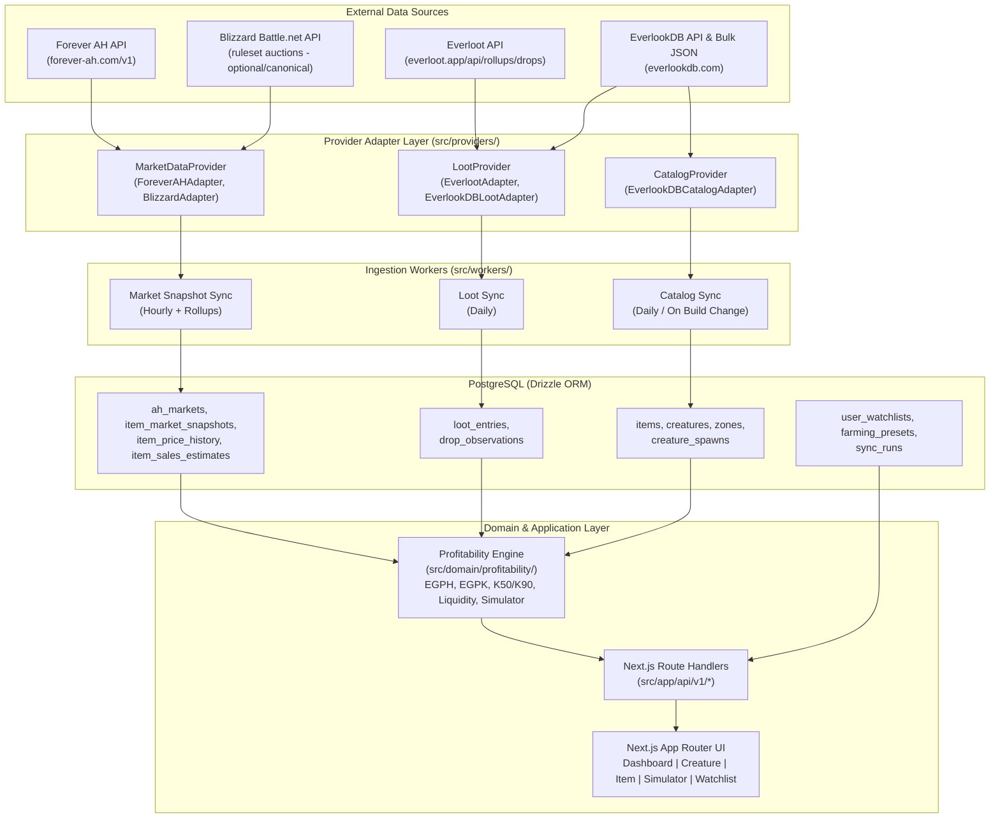

# SYSTEM ARCHITECTURE — WOW FOREVER FARM OPTIMIZER

- **Status:** Proposed Architecture (Phase 1 Feasibility Assessment — Pending User Approval)
- **Date:** 2026-11-21
- **Specification Reference:** `PROJECT_SPEC.md`, `AGENTS.md`, `docs/DATA_SOURCES.md`

---

## 1. Architecture Principles

1. **Data Honesty First:** Every displayed price, drop probability, sales velocity, and gold/hour figure carries explicit provenance (`ACTUAL` | `CALCULATED` | `ESTIMATED` | `MISSING`), confidence tier (`VERIFIED` | `OBSERVED` | `ESTIMATED` | `UNKNOWN`), source attribution, and freshness timestamp.
2. **Decoupled Provider Adapters:** External APIs (`forever-ah.com`, Blizzard Battle.net API, `everloot.app`, `everlookdb.com`) are isolated behind typed adapter interfaces. Business logic and UI never call third-party APIs directly.
3. **Database-Backed Reads (Zero Live Fan-Out):** Scheduled ingestion workers pull hourly AH snapshots and daily catalog/loot updates into PostgreSQL. All user dashboard queries, filters, and rankings run against PostgreSQL — respecting external rate limits (~1 req/s) and surviving upstream outages gracefully.
4. **Pure, Deterministic Profitability Engine:** All economic math lives in a framework-agnostic, strictly typed domain module (`src/domain/profitability/`) with 100% unit-test coverage on formulas and edge cases.
5. **No Secrets in Frontend:** Blizzard OAuth tokens, API keys, and DB credentials reside strictly in server-side environment variables.

---

## 2. Technology Stack Evaluation

| Layer | Proposed in `PROJECT_SPEC.md` | Evaluation & Recommendation | Rationale & Verified Local Constraints |
|---|---|---|---|
| **Frontend / Full-Stack** | Next.js + React + TypeScript | **Approve: Next.js (App Router) + React 19 + TypeScript (`strict: true`)** | SSR/RSC for fast, indexable Creature & Item pages; shared strict TS types across DB, engine, API routes, and UI. Node `v24.13.0` is verified installed locally. |
| **Styling & UI** | Tailwind CSS + shadcn/ui | **Approve: Tailwind CSS + shadcn/ui** | Clean dense analytical tables, accessible Radix primitives, dark-charcoal/gold-bronze theme, zero heavy runtime overhead. |
| **Charts** | Recharts | **Approve: Recharts** | Supports responsive 24h/7d/30d price, supply, sales volume, and historical profitability charts in React. |
| **Backend & Jobs** | Next.js API routes or dedicated backend + background workers | **Approve Modular Monolith:** Next.js Route Handlers + standalone TS worker CLI scripts (`src/workers/`) | Avoids premature microservices while keeping clean module boundaries (`providers/`, `workers/`, `domain/`, `db/`, `app/`). Workers run via OS cron, GitHub Actions, or container scheduler. |
| **Database** | PostgreSQL | **Approve PostgreSQL — Requires Provisioning Decision** | Ideal for relational loot tables, time-series market snapshots, `pg_trgm` fuzzy search, and ranking aggregations. **Local gap verified:** neither `psql` nor `docker` is installed on this Windows machine. Decision needed: install PostgreSQL/Docker locally OR use managed PostgreSQL (e.g., Neon/Supabase) for dev & prod. |
| **ORM** | Prisma or Drizzle | **Recommend: Drizzle ORM** | SQL-first query builder fits complex EGPH aggregations, CTEs, and window functions better than Prisma; zero binary query-engine overhead; lightweight TypeScript schema definitions. |
| **Caching** | Redis, if justified | **Defer Redis until Phase 5** | Because workers ingest snapshots hourly into PostgreSQL, user traffic does not hit external APIs. Indexed Postgres summary tables + Next.js server cache / HTTP `Cache-Control` headers handle MVP traffic without adding Redis ops overhead. |
| **Testing & Validation** | Automated tests + input validation | **Recommend: Vitest + Zod** | Fast TS-native unit/integration tests (`vitest`) + strict runtime validation (`zod`) on all external API payloads and user query parameters. |
| **Package Manager / Shell** | npm (default) | **Use `npm.cmd` (or update PS ExecutionPolicy)** | Verified locally: `pnpm` and `yarn` are not installed; PowerShell execution policy blocks `npm.ps1` (`npm.cmd` works, or user enables `RemoteSigned`). |

---

## 3. High-Level System Architecture



---

## 4. Provider Adapter Contracts

All external integrations implement strict TypeScript interfaces under `src/providers/`:

```ts
export interface MarketDataProvider {
  readonly sourceId: 'forever_ah' | 'blizzard_api' | 'ahledger';
  fetchMarkets(): Promise<NormalizedMarket[]>;
  fetchMarketSnapshot(marketKey: string): Promise<NormalizedItemMarketRow[]>;
  fetchItemHistory?(marketKey: string, itemId: number, days: number): Promise<NormalizedPricePoint[]>;
}

export interface CatalogProvider {
  readonly sourceId: 'everlookdb' | 'wclbox';
  fetchItems(): Promise<NormalizedItem[]>;
  fetchCreatures(): Promise<NormalizedCreature[]>;
  fetchZones(): Promise<NormalizedZone[]>;
}

export interface LootObservationProvider {
  readonly sourceId: 'everloot' | 'everlookdb_players' | 'classic_db';
  fetchCreatureDrops(): Promise<NormalizedDropObservation[]>;
}
```

### Resilience & Rate-Limit Rules
- **Schema validation:** Every upstream response is parsed with `zod`; malformed records are quarantined and logged to `sync_runs` rather than corrupting existing snapshots.
- **Politeness:** Token-bucket rate limiter per provider (`<= 1 req/s` for Forever AH; `<= 5 req/s` unauth or `<= 25 req/s` keyed for EverlookDB; honors `Retry-After` on `429` and `Cache-Control` headers).
- **Graceful Degradation:** If an hourly market sync fails, the application continues serving the last valid `item_market_snapshots` row and surfaces a staleness banner with the exact age (`last_snapshot_at`).

---

## 5. Normalized Database Schema (PostgreSQL + Drizzle)

Core tables aligned to `PROJECT_SPEC.md` Section 10:

1. **`zones`**: `id` (PK, UiMap ID), `name`, `continent`, `min_level`, `max_level`, `is_instance`, `source`, `client_build`.
2. **`items`**: `id` (PK, Blizzard item ID), `name`, `quality` (0–7 enum), `item_class`, `item_subclass`, `item_level`, `required_level`, `bind_type` (`none` | `boe` | `bop` | `bou` | `quest`), `vendor_sell_copper` (bigint), `max_stack`, `is_commodity` (boolean), `icon_url`, `description`, `forever_status` (`same` | `changed` | `new` | `rebuilt` | `unknown`), `source`, `client_build`, `updated_at`.
3. **`creatures`**: `id` (PK, NPC ID), `name`, `min_level`, `max_level`, `creature_type`, `classification` (`normal` | `elite` | `rare` | `rare_elite` | `boss`), `faction_restriction`, `health_min`, `health_max`, `primary_zone_id` (FK → `zones.id`), `raw_coin_min_copper`, `raw_coin_max_copper`, `raw_coin_source`, `source`, `client_build`, `updated_at`.
4. **`creature_spawns`**: `id` (PK), `creature_id` (FK), `zone_id` (FK), `subzone`, `x` (numeric), `y` (numeric), `source`, `confidence_tier`, `sample_size`.
5. **`drop_observations`** (raw per-source records, never overwritten across sources): `id` (PK), `creature_id` (FK), `item_id` (FK), `loot_method` (`kill` | `skinning` | `pickpocket`), `source` (`everloot` | `everlookdb_players` | `classic_db`), `kills_observed`, `drops_observed`, `total_qty_observed`, `min_qty`, `max_qty`, `drop_rate` (numeric), `ci_low`, `ci_high`, `reporter_count`, `confidence_tier` (`VERIFIED` | `OBSERVED` | `ESTIMATED` | `UNKNOWN`), `is_quest_only`, `client_build`, `observed_at`.
   - Unique constraint on `(creature_id, item_id, loot_method, source)`.
6. **`creature_loot_resolved`** (materialized/resolved table applying precedence rules so there is **zero double-counting**): One active row per `(creature_id, item_id, loot_method)` pointing to the winning `drop_observation_id`, effective `drop_rate`, `avg_qty`, `confidence_tier`, `sample_size`, `source`.
7. **`ah_markets`**: `id` (PK, e.g. `us:110`), `region` (`us` | `eu` | `kr` | `tw`), `ruleset_id`, `ruleset_label` (nullable until verified, e.g. `Normal` | `PvP` | `RP` | `RP-PvP`), `house_id` (int, e.g. `110`), `faction` (`alliance` | `horde` | `neutral` | `unified`), `default_commission_rate` (numeric: `0.05` faction, `0.15` neutral), `provider_key` (e.g. Forever AH `house_key`), `last_snapshot_at`.
8. **`item_market_snapshots`** (latest state per `(market_id, item_id)`): `market_id` (FK), `item_id` (FK), `lowest_buyout_copper`, `p10_copper`, `median_copper`, `mean_copper`, `market_value_copper`, `clearing_price_copper` (computed), `available_qty`, `listing_count`, `trend_7d_pct`, `trend_30d_pct`, `source`, `snapshot_at`.
   - Primary key `(market_id, item_id)`.
9. **`item_price_history`** (time-series): `market_id`, `item_id`, `bucket_ts` (timestamptz), `resolution` (`hour` | `day`), `min_copper`, `p10_copper`, `median_copper`, `mean_copper`, `available_qty`, `listing_count`, `source`.
   - Composite PK `(market_id, item_id, resolution, bucket_ts)` + index on `(item_id, market_id, bucket_ts DESC)`.
10. **`item_sales_estimates`**: `market_id`, `item_id`, `estimated_sold_per_day` (numeric, nullable), `days_seen`, `liquidity_score` (0–100, nullable), `selling_prob_24h` (nullable), `selling_prob_7d` (nullable), `data_status` (`ESTIMATED` | `MISSING`), `source`, `computed_at`.
11. **`user_watchlists`** & **`farming_presets`**: Keyed by `user_id` (or anonymous `session_token` for MVP before optional auth) storing saved items, alert thresholds, custom KPH, expenses `E`, commission overrides, and preferred market/faction.
12. **`sync_runs`**: Operational audit log (`provider`, `job_type`, `status`, `records_processed`, `records_failed`, `started_at`, `finished_at`, `error_summary`).

---

## 6. Profitability Engine Specification (`src/domain/profitability/`)

### 6.1 Extended Primary Formula (EGPH)

Base formula from `PROJECT_SPEC.md`:
$$\text{EGPH} = K \times \sum_{i} \left( P_i \times Q_i \times V_i \times (1 - C_i) \times S_i \right) - E$$

**Critical Domain Refinements (Addressing Spec Edge Cases):**
Every loot item $i$ is routed to its economically rational liquidation channel rather than assuming every drop goes to the Auction House:

1. **Quest-only / Unsellable items:** $V_i = 0$.
2. **Bind-on-Pickup (BoP) or Poor (Gray) items:** Liquidated at NPC vendor → $V_i = V_{\text{vendor}}$, $C_i = 0$, $S_i = 1.0$ (instant, guaranteed liquidity).
3. **Auctionable items (Trade Goods, BoE gear, Consumables, Recipes):**
   - Compute expected net AH realization: $R_{\text{AH},i} = V_{\text{clear},i} \times (1 - C_{\text{market}}) \times S_i - D_i \times (1 - S_i)$, where $V_{\text{clear},i}$ is the conservative clearing price (default: `min(p10, median, market_value)` or configurable price basis: lowest / p10 / median), $C_{\text{market}}$ is configurable per market type (default `0.05` Alliance/Horde, `0.15` Blackwater), and $D_i$ is optional configurable deposit cost.
   - Compare against guaranteed vendor floor $V_{\text{vendor},i}$: if $R_{\text{AH},i} \le V_{\text{vendor},i}$ (or item has no AH listings), liquidate to vendor ($V_i = V_{\text{vendor},i}, C_i = 0, S_i = 1.0$).
4. **Raw Coin Drops (when available):** Treated as $C = 0, S = 1.0$ additive component (`avg_coin_per_kill`).
5. **Dual Reporting When $S_i$ Is Unknown:**
   - Per `PROJECT_SPEC.md` Section 3: *"If sales information is unavailable, explicitly indicate that the selling probability is unknown rather than inventing it."*
   - Therefore the engine outputs **both**:
     - `egph_liquidity_adjusted`: Applies $S_i$ where estimable, explicitly flags items with unknown $S_i$ (configurable behavior: exclude unknown-$S_i$ AH value vs include at user-chosen fallback discount, defaulting to transparent split!).
     - `egph_gross_ev`: Assumes $S_i = 1.0$ (theoretical EV if all drops sell) — always labeled separately so users see the liquidity haircut clearly.

### 6.2 Secondary Metrics & Edge Cases

- **Expected Gold per Kill:** $\text{EGPK} = \text{EGPH} / K$ (if $K \le 0$, return `null` / validation error; note pre-expense gross EV per kill is computed independently of $K$).
- **Expected Kills per Drop:** $\text{Kills} = 1 / P_i$ (if $P_i \le 0$, return `null`).
- **Probability of $\ge 1$ Drop in $k$ Kills:** $P(\ge 1) = 1 - (1 - p)^k$ (clamped: if $p \le 0 \Rightarrow 0$; if $p \ge 1$ and $k \ge 1 \Rightarrow 1$; if $k = 0 \Rightarrow 0$).
- **Kills for 50% / 90% Probability:**
  - $K_{50} = \lceil \ln(0.5) / \ln(1 - p) \rceil$, $K_{90} = \lceil \ln(0.1) / \ln(1 - p) \rceil$
  - Edge cases: if $p \le 0 \Rightarrow \text{null}$ (impossible); if $p \ge 1 \Rightarrow 1$.

### 6.3 Liquidity Score (0–100) & Selling Probability ($S_i$)

Kept strictly separate from drop probability $P_i$. Computed from:
1. **Estimated Daily Sales Velocity (`sold_per_day`)** (log-scaled demand score).
2. **Supply-to-Demand Ratio (`available_qty / max(sold_per_day, 0.01)`)** (measures competition/overhang in days of supply).
3. **Price Stability** (7d / 30d coefficient of variation / volatility penalty).
4. **Observation Breadth (`days_seen`)** (confidence penalty for newly seen items).

If `sold_per_day` is `null`, `liquidity_status = "UNKNOWN"` and `selling_probability = null` (never fabricated).

### 6.4 Farming Simulator

Given `(creature, duration_hours, kills_per_hour, market, trials)`:
- **Analytical EV panel:** Exact mathematical expected drops, expected vendor gold, expected AH gold, expected net EGPH.
- **Simulated Session panel:** Binomial/Bernoulli Monte Carlo trials per loot entry (with optional seed for reproducible tests) showing single-run loot outcome + 10th/50th/90th percentile distribution across $N$ simulated sessions — visually separated from statistical EV.

---

## 7. Security, Performance & Observability

- **Secrets:** Stored only in `.env.local` / deployment secret manager (`.env*` excluded in `.gitignore`). Never prefixed with `NEXT_PUBLIC_`.
- **Query Performance:**
  - Precompute per-market baseline `gross_ev_per_kill` and `liquidity_adjusted_ev_per_kill` per creature after each hourly market sync into an indexed summary table/materialized view so Dashboard ranking queries return in `< 100ms`, while dynamic user overrides (custom `K`, `E`, `C`, confidence filter) apply cheaply via SQL arithmetic (`K * ev_per_kill - E`).
- **Observability:** `/api/v1/health` reports DB connectivity and latest `sync_runs` age per provider; UI header shows live market snapshot age.

---

## 8. Explicit Assumptions & Open Decisions for User Approval

| # | Decision / Assumption | Default Proposal | Needs User Confirmation? |
|---|---|---|---|
| 1 | **PostgreSQL Provisioning** (no local Docker/psql installed) | Use managed PostgreSQL (e.g., Neon free tier) or user installs PostgreSQL/Docker locally | **Yes** |
| 2 | **Blizzard Developer API Credentials** | Start Phase 2 with Forever AH (zero auth), design canonical Blizzard API adapter in parallel | **Yes** (do you have/want a Battle.net dev app?) |
| 3 | **Project Licensing & Commercial Intent** | Non-commercial / open-source community tool (aligns cleanly with Blizzard API ToS, CC BY-SA 4.0, GPL-3.0 boundary) | **Yes** |
| 4 | **Default Dashboard Confidence Filter** | Include `VERIFIED` + `OBSERVED` + `ESTIMATED` (Classic 1.12) with prominent badges and a one-click *"Forever Verified/Observed Only"* toggle (because Forever-only has ~60 NPCs today) | **Yes** |
| 5 | **User Accounts for Watchlists/Alerts** | Browser `localStorage` + shareable preset URLs in MVP (Phase 4), optional DB-backed auth later | **Yes** |
| 6 | **Missing "Lowest Competition" Sort Metric** | No API provides real-time zone player counts; either omit or use transparent proxy (`AH listing overhang / days of supply` labeled as *Market Competition Proxy*) | **Yes** |
